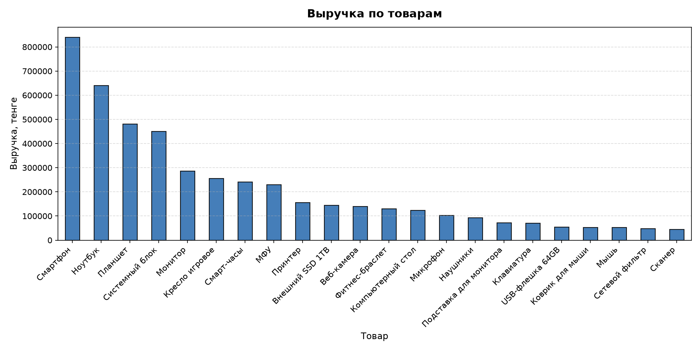
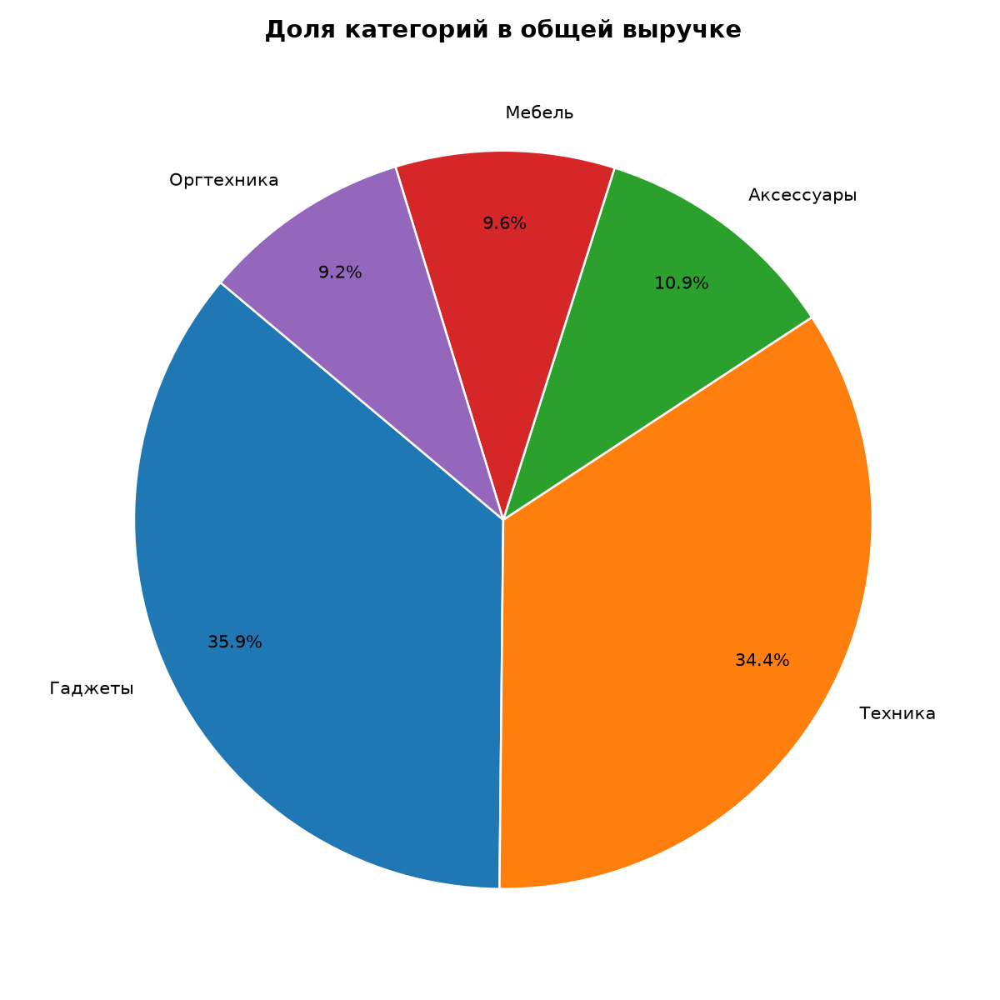
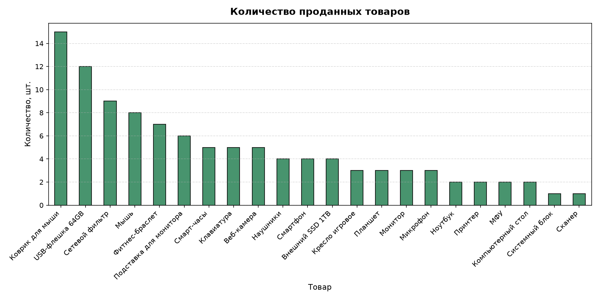

# Практическая работа: Анализ данных продаж магазина (День 2)

Проект для загрузки данных из базы SQLite (`shop.db`), расчёта ключевых показателей продаж с помощью `pandas` и построения визуализаций с помощью `matplotlib`.

## Структура проекта

- `analysis.py` — основной скрипт анализа данных и генерации графиков.
- `shop.db` — база данных SQLite с таблицей `sales` (22 записи о продажах).
- `charts/` — папка с сохранёнными графиками в формате PNG:
  - `charts/revenue_by_product.png` — столбчатая диаграмма выручки по товарам;
  - `charts/revenue_by_category.png` — круговая диаграмма долей категорий в общей выручке;
  - `charts/quantity_by_product.png` — столбчатая диаграмма количества проданных товаров.

## Установка и запуск

```bash
python -m pip install pandas matplotlib
python analysis.py
```

## Основные результаты анализа

### 1. Ключевые показатели
- **Общая выручка магазина:** `4 699 800 тенге`
- **Общее количество проданных единиц:** `106 шт.`

### 2. ТОП-3 товара с максимальной выручкой
| Место | Товар | Категория | Цена, тенге | Кол-во, шт. | Выручка, тенге | Доля в выручке |
| :---: | :--- | :--- | :---: | :---: | :---: | :---: |
| 1 | Смартфон | Гаджеты | 210 000 | 4 | 840 000 | 17.9% |
| 2 | Ноутбук | Техника | 320 000 | 2 | 640 000 | 13.6% |
| 3 | Планшет | Гаджеты | 160 000 | 3 | 480 000 | 10.2% |

Суммарно три лидера приносят **1 960 000 тенге** (**41.7%** общей выручки).

### 3. Выручка и продажи по категориям
| Категория | Выручка, тенге | Доля в выручке | Продано, шт. |
| :--- | :---: | :---: | :---: |
| Гаджеты | 1 689 500 | 35.9% | 19 |
| Техника | 1 617 000 | 34.4% | 14 |
| Аксессуары | 511 300 | 10.9% | 57 |
| Мебель | 451 000 | 9.6% | 11 |
| Оргтехника | 431 000 | 9.2% | 5 |

### 4. Лидеры по количеству проданных единиц
1. **Коврик для мыши** — `15 шт.` (`52 500 тенге`)
2. **USB-флешка 64GB** — `12 шт.` (`54 000 тенге`)
3. **Сетевой фильтр** — `9 шт.` (`46 800 тенге`)

## Визуализации

### Выручка по товарам


### Доля категорий в общей выручке


### Количество проданных товаров


## Выводы по полученным результатам

1. **Две ключевые категории формируют основу выручки:** категории «Гаджеты» (`35.9%`, `1 689 500 тенге`) и «Техника» (`34.4%`, `1 617 000 тенге`) вместе приносят **70.3%** всех доходов магазина, тогда как на остальные три категории («Аксессуары», «Мебель», «Оргтехника») приходится менее трети выручки.
2. **Высокая концентрация доходов в ТОП-3 товаров:** смартфоны, ноутбуки и планшеты обеспечивают **41.7%** общей выручки при продажах всего в `9 шт.` из `106` (`8.5%` от общего объёма в штуках).
3. **Лидеры по объёму продаж и по выручке различаются:** по количеству проданных единиц лидируют бюджетные аксессуары (категория «Аксессуары» дала **57 шт.**, или `53.8%` всех проданных единиц, но только `10.9%` выручки), тогда как основной финансовый результат обеспечивают дорогостоящие устройства.
